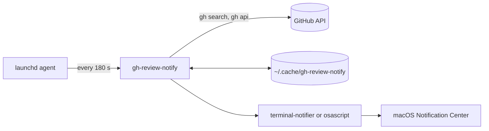
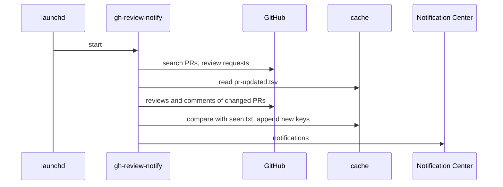

# Architecture

gh-review-notify is one bash script that a macOS `launchd` agent starts every
few minutes. It reads GitHub through the `gh` CLI and shows notifications
through `terminal-notifier`.

## Parts

- **`gh-review-notify`** the script. `main` runs the steps below in order.
- **`install.sh`** copies the script to `~/.local/bin`, writes the agent plist
  and loads it.
- **`uninstall.sh`** unloads the agent and deletes the files `install.sh` made.
- **`tests/`** canned GitHub answers, stubs for `gh`, `date` and
  `terminal-notifier`, and the expected output.

## One run

1. **Lock** `take_lock` makes `lock/`. A second run quits at once.
2. **List PRs** `list_involved_prs` searches open PRs you authored, take part
   in or reviewed, updated in the last 3 days. A failed search stops the run
   before any cache file changes.
3. **Review requests** `collect_review_requests` keeps the requests that name
   you, and drops the team ones. A failed lookup stays out of the cache, so
   the next run asks again.
4. **Read events** `collect_pr_events` reads reviews and comments of each PR
   whose `updatedAt` moved. A comment counts when it was written in the last
   3 days, whatever its last edit.
5. **Drop seen events** `keep_unseen_events` checks each event key against
   `seen.txt`.
6. **Notify** `deliver_notifications` shows approvals alone and folds more
   than 4 comments on a PR into 1.

## Data

The script keeps its state in `~/.cache/gh-review-notify`:

| File | Holds |
| --- | --- |
| `seen.txt` | the key of each event already shown, the last 3000 |
| `pr-updated.tsv` | PR url and the `updatedAt` read last time |
| `review-requests.tsv` | PR url, `updatedAt`, and `personal` or `team` |
| `lock/` | present while a run is going |

An event key is the GitHub URL of the review or comment. A review request uses
the PR URL plus `#review-requested`.

## Outside services

- **GitHub** through `gh search prs` and `gh api`, with the login of `gh auth`.
- **Homebrew** installs `jq` and `terminal-notifier` at install time.
- **launchd** runs the agent `io.github.gh-review-notify`.
