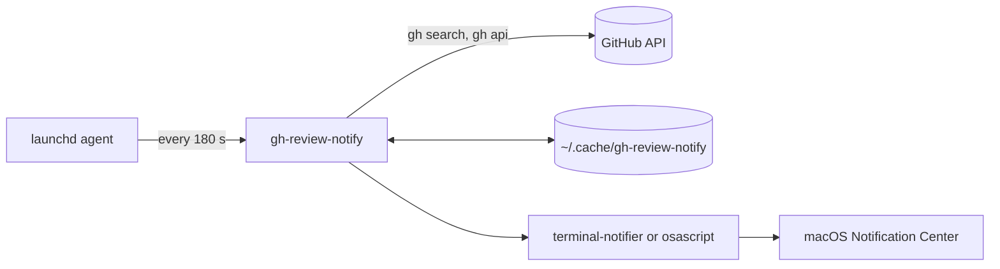
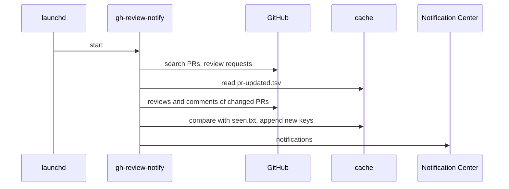

# Architecture

gh-review-notify is one bash script that a macOS `launchd` agent starts every
few minutes. It reads GitHub through the `gh` CLI and shows notifications
through `terminal-notifier`.

## Parts

- **`gh-review-notify`** the script. `main` runs the steps below in order.
- **`install.sh`** copies the script to `~/.local/bin`, writes the agent plist
  and loads it.
- **`uninstall.sh`** unloads the agent and deletes the files `install.sh` made.
- **`tests/`** canned GitHub answers, stubs for `gh`, `date` and
  `terminal-notifier`, and the expected output.

## One run

1. **Lock** `take_lock` makes `lock/`. A second run quits at once.
2. **List PRs** `list_involved_prs` searches open PRs you authored, take part
   in or reviewed, updated in the last 3 days. A failed search stops the run
   before any cache file changes.
3. **Review requests** `collect_review_requests` keeps the requests that name
   you, and drops the team ones. A failed lookup stays out of the cache, so
   the next run asks again.
4. **Read events** `collect_pr_events` reads reviews and comments of each PR
   whose `updatedAt` moved. A conversation comment counts when it was written
   in the last 3 days, whatever its last edit.
5. **Drop seen events** `keep_unseen_events` checks each event key against
   `seen.txt`.
6. **Notify** `deliver_notifications` shows approvals alone and folds more
   than 4 comments on a PR into 1.

## Data

The script keeps its state in `~/.cache/gh-review-notify`:

| File                  | Holds                                              |
| --------------------- | -------------------------------------------------- |
| `seen.txt`            | the key of each event already shown, the last 3000 |
| `pr-updated.tsv`      | PR url and the `updatedAt` read last time          |
| `review-requests.tsv` | PR url, `updatedAt`, and `personal` or `team`      |
| `lock/`               | present while a run is going                       |

An event key is the GitHub URL of the review or comment. A review request uses
the PR URL plus `#review-requested`.

## Outside services

- **GitHub** through `gh search prs` and `gh api`, with the login of `gh auth`.
- **Homebrew** installs `jq` and `terminal-notifier` at install time.
- **launchd** runs the agent `io.github.gh-review-notify`.

## Decisions

### Platform: macOS only

- **Picked** a `launchd` user agent and macOS Notification Center.
- **Why** the tool was built for the Mac the person reviewed code on.
  `launchd` gives a timer that catches up on wake, and `terminal-notifier`
  opens a URL on click.
- **Trade-off** Windows and Linux get no notifications. Development moved to
  Windows, and the Windows installer in `local-ci` skips this tool.
- **Rejected**
  - **A cross platform app** each OS needs its own timer and notifier.
- **Cost to undo** high. The agent, the notifier calls and `install.sh`
  change.

### Language: one bash script

- **Picked** `gh-review-notify` is a single bash file that calls `gh`, `jq`
  and `terminal-notifier`.
- **Why** the job is glue between CLIs that the Mac already has or Homebrew
  installs. One file copies into `~/.local/bin` with no build and no
  runtime. No source records why bash won.
- **Trade-off** the org rule writes scripts in TypeScript run by Node, so the
  tool is off that rule. Bash has no types, and the tests need stubs for
  `gh`, the BSD `date` and the notifier.
- **Rejected**
  - **TypeScript run by Node** the Mac would need Node through mise for a
    background job.
  - **Rust** a binary per CPU to build and ship, for a script under 400
    lines.
- **Cost to undo** high. A rewrite of the script and its tests.

### Delivery: poll GitHub every 3 minutes

- **Picked** the agent starts the script every 180 seconds.
  `GH_REVIEW_NOTIFY_INTERVAL` changes it.
- **Why** GitHub tells by email, and an approval waits for hours when mail
  gets checked twice a day. A poll needs no server.
- **Trade-off** an event shows up to 3 minutes late, and only while the Mac
  is awake.
- **Rejected**
  - **GitHub email** too slow, as above.
  - **The GitHub app for Slack** it posts each review in the repo with no
    "only mine" filter. `/github subscribe` refuses to run in a DM.
  - **Webhooks** GitHub would need a public address that reaches the Mac.
- **Cost to undo** medium. The agent plist and the run loop change.

### GitHub access: the `gh` CLI

- **Picked** each call goes through `gh search prs` and `gh api` with the
  `gh auth` login.
- **Why** `gh` keeps the login, so the tool stores no token. The install
  fetches its files through `gh api` too, since a private repo broke the
  `raw.githubusercontent.com` link.
- **Trade-off** the tool stops when `gh` loses its login. It works with
  github.com only.
- **Rejected**
  - **`curl` with a token** the tool would need to store and refresh a
    token.
- **Cost to undo** medium. Every GitHub call changes.

### State: flat files in `~/.cache/gh-review-notify`

- **Picked** `seen.txt` holds the last 3000 event keys. The `.tsv` files
  hold the `updatedAt` of each PR.
- **Why** `grep` and `awk` read them from bash, and a run reopens only the
  PRs whose `updatedAt` moved. A later run then takes under 10 seconds.
- **Trade-off** the files carry no format number. A new format takes a new
  file name, and the script then reseeds.
- **Rejected**
  - **SQLite** bash would need the `sqlite3` CLI and SQL for a list of URLs.
  - **No cache** each run would read every PR, which takes a minute.
- **Cost to undo** low. The script reseeds from GitHub on its next run.

### Noise filter: people only, with bursts folded

- **Picked** bot comments stay out, team review requests drop, and more than
  4 comments on one PR fold into 1. Approvals and change requests come on
  their own.
- **Why** CodeRabbit and Semgrep post dozens of comments and hide the people.
  Most review request noise came from team requests.
- **Trade-off** a person who wants bot comments sets
  `GH_REVIEW_NOTIFY_BOTS=1`.
- **Rejected**
  - **One notification per event** 10 inline comments gave 10 pop ups.
- **Cost to undo** low. `deliver_notifications` and the filters.

### Notifier: `terminal-notifier` with an `osascript` fallback

- **Picked** `terminal-notifier` when it is installed. `osascript` shows the
  text when it is missing.
- **Why** a click on a `terminal-notifier` alert opens the exact comment.
- **Trade-off** Homebrew installs one more package.
- **Rejected**
  - **`osascript` only** `display notification` takes no click action.
- **Cost to undo** low. One function.

### Install source and CI: latest `main`, checks on GitHub runners

- **Picked** `install.sh` fetches the latest `main`. Checks run on a GitHub
  macOS runner, and each green push gets a date release.
- **Why** the repo is public, so GitHub runners cost 0 minutes and fork code
  stays off the PC.
- **Trade-off** an install can pick up a commit before its checks on `main`
  finish.
- **Rejected**
  - **The PC runner** a public repo would run outside code on the PC.
  - **A Homebrew tap** it needs a formula update per release.
- **Cost to undo** low. `install.sh` and the workflows.
