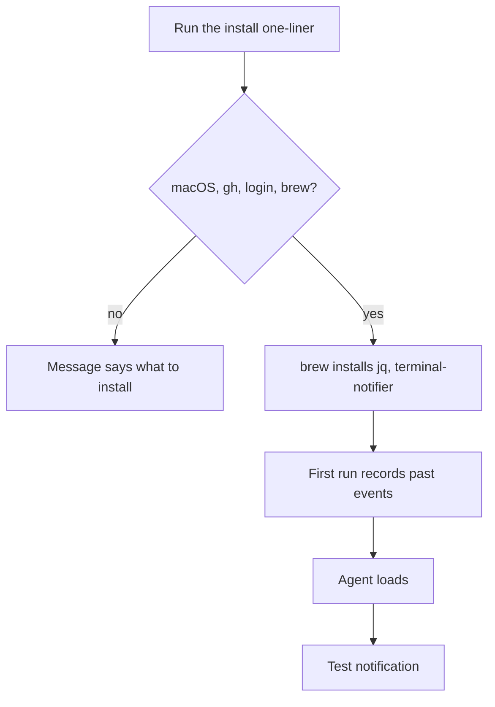
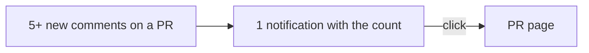
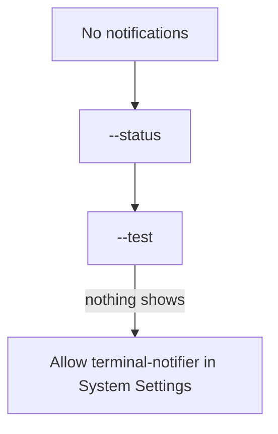
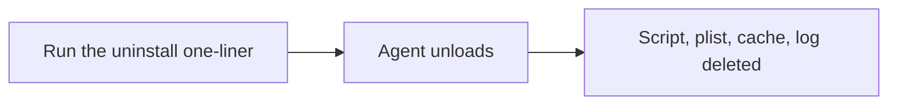

# User flows

## Install

1. The person runs the `gh api ... install.sh` one-liner from the README.
2. `install.sh` checks for macOS, `gh`, the `gh` login and Homebrew.
3. Homebrew installs `jq` and `terminal-notifier` if they are missing.
4. The first run records the last 3 days of events without notifications.
5. The agent loads, and a test notification shows.

## A review lands

1. A person approves, asks for changes or comments on a PR you take part in.
2. Within 3 minutes the agent runs the script.
3. A notification shows the kind, the PR, the person and the time.
4. A click opens the comment on GitHub.

## A comment burst

1. A reviewer leaves 5 or more inline comments at once.
2. The next run shows 1 notification, "💬 N new comments", with the names.
3. A click opens the PR.

## Troubleshoot

1. The person runs `gh-review-notify --status` to see the agent, the account
   and the last run.
2. `gh-review-notify --test` sends a test notification.
3. With no test notification, the person allows terminal-notifier in System
   Settings > Notifications.

## Uninstall

1. The person runs the `gh api ... uninstall.sh` one-liner.
2. The agent stops, and the script, plist, cache and log go away.

